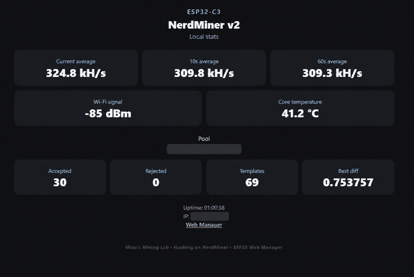
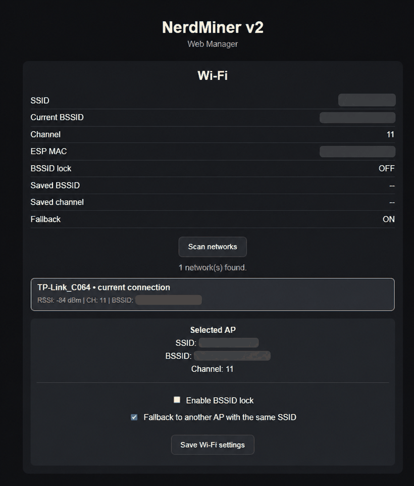
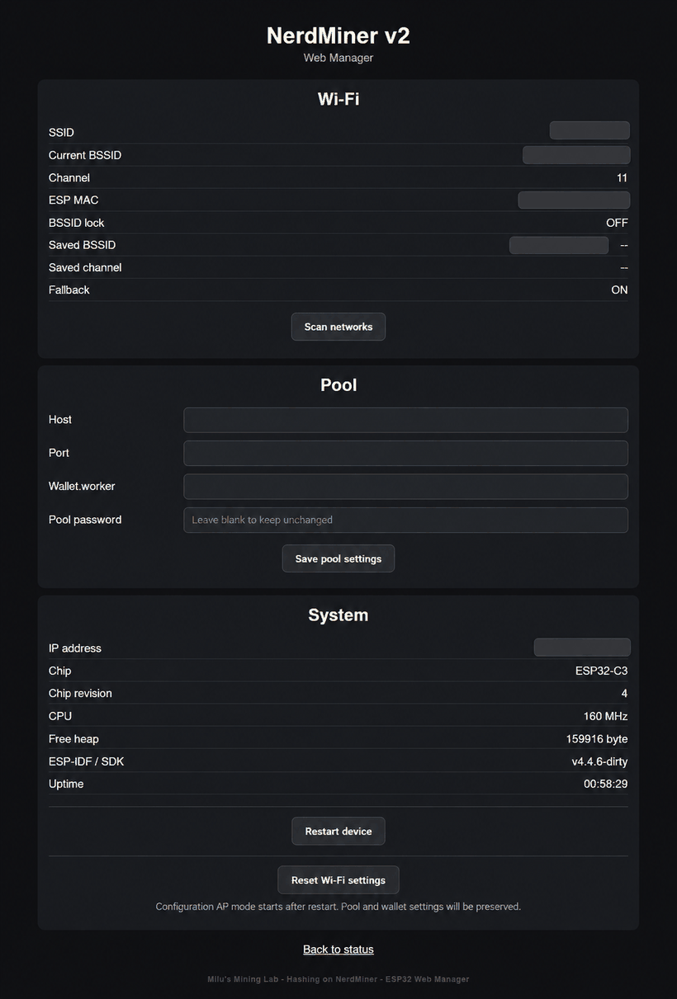

# NerdMiner v2 Web Manager & ESP32 Optimization Fork

An enhanced fork of **NerdMiner v2** focused on the **ESP32-C3 SuperMini**, browser-based configuration, Wi-Fi management and SHA256 mining performance.

This fork adds an integrated **ESP32 Web Manager**, BSSID/AP control, improved Wi-Fi fallback, browser-based pool configuration and mining optimizations.

> **Hardware testing status:** At the moment, real-world testing has only been completed on the **ESP32-C3 SuperMini**.  
> Builds for other ESP32 / ESP32-S2 / ESP32-S3 boards are being tested for compatibility, but they have not yet received the same level of real-world hardware testing.
>
> Feedback, bug reports and compatibility results from other boards are very welcome. If something needs fixing or improving, please open an issue.

## ESP32-C3 SuperMini SHA256 optimization

The ESP32-C3 SHA256 mining path was optimized to reduce unnecessary work in the hardware SHA loop.

Real-world test results on an **ESP32-C3 SuperMini at the standard 160 MHz CPU frequency**:

| Version | Hashrate |
|---|---:|
| Original / baseline | ~259.6 kH/s |
| Optimized | ~308.3 kH/s |
| Improvement | **~18.8%** |

No CPU overclocking was used for these measurements.

The optimized firmware has been tested with accepted shares and without rejects caused by the optimization.

These results were measured on the tested ESP32-C3 SuperMini and should not be assumed to be identical on every ESP32 board.

### Planned: overclocked version

A separate **overclocked ESP32-C3 SuperMini version is planned** for users who want to experiment with higher performance.

The current main version intentionally remains at the standard **160 MHz** CPU frequency.

The future overclocked build will be kept separate so users can choose between standard-frequency stability and experimental higher performance.

## Integrated ESP32 Web Manager

This fork adds a lightweight browser-based Web Manager directly to NerdMiner.

Features include:

- Real-time hashrate monitoring
- Current, 10-second and 60-second hashrate
- Accepted and rejected share statistics
- Best difficulty and template statistics
- Pool connection information
- Wi-Fi signal strength
- ESP32 chip model and system information
- Pool host, port, wallet/worker and password configuration
- Wi-Fi network scanning
- BSSID / access-point selection
- Optional BSSID locking
- Automatic fallback to another AP using the same SSID
- Browser-based device restart
- Wi-Fi reset without deleting mining pool settings
- Dynamic HMPool support integration for BTC, BCH, DigiByte and eCash
- Improved first-time configuration experience
- Mobile-friendly Web Manager interface

The Web Manager is especially useful for **headless ESP32-C3 SuperMini NerdMiner devices**, where configuration and monitoring would otherwise require serial access.


### Web Manager screenshots

#### Live mining statistics



#### Wi-Fi and BSSID management



#### Pool and system configuration



## Improved Wi-Fi and BSSID handling

For networks with multiple access points using the same SSID, the firmware can:

- select a specific BSSID,
- lock the miner to a selected access point,
- remember the selected Wi-Fi channel,
- fall back to another AP using the same SSID,
- recover through WiFiManager configuration mode when needed.

This can be useful with mesh Wi-Fi systems, repeaters and homes with multiple access points.

## Compatibility

The project is intended to remain compatible with the wider NerdMiner v2 ESP32 board ecosystem.

However:

**Real-world hardware testing of these modifications has currently only been completed on the ESP32-C3 SuperMini.**

Successful compile tests have also been completed for:

- ESP32 DevKit v1
- ESP32-S2 Mini Wemos
- ESP32-S3 DevKit v1

These boards have not yet been tested on real hardware with this fork.

Testing and feedback from:

- ESP32
- ESP32-S2
- ESP32-S3
- other ESP32-C3 boards

is very welcome.

If you test this fork on another board, please report whether the Web Manager, Wi-Fi features and mining functions work correctly.

## Support development

If the Web Manager or ESP32 optimizations are useful to you, you can optionally support further development.

**Bitcoin donation address:**

`bc1qeedpdfke2gzexpnal54wcsewjvr65d8v0lfgfg`

Donations are completely optional.

---

# Magyar leírás

Ez a **NerdMiner v2** egy módosított változata, amely elsősorban az **ESP32-C3 SuperMini** használhatóságára, webes kezelésére, Wi-Fi kezelésére és SHA256 bányászati teljesítményére koncentrál.

A fork egy beépített **ESP32 Web Managert**, BSSID/AP kezelést, jobb Wi-Fi fallback működést, böngészőből módosítható pool beállításokat és bányászati optimalizálásokat tartalmaz.

> **Hardveres teszt állapota:** jelenleg a módosításokat élesben kizárólag **ESP32-C3 SuperMini** hardveren teszteltem.
>
> Más ESP32 / ESP32-S2 / ESP32-S3 boardokra a kompatibilitási fordítások készülnek, de ezeken még nem történt ugyanolyan szintű valós hardveres teszt.
>
> Szívesen várok visszajelzéseket, hibajelentéseket és más boardokon végzett teszteredményeket. Ha valamit javítani vagy módosítani kell, nyiss egy Issue-t.

## ESP32-C3 SuperMini SHA256 optimalizálás

Az ESP32-C3 hardveres SHA256 bányászati ciklusát optimalizáltam, több felesleges művelet eltávolításával.

Valós mérési eredmény **ESP32-C3 SuperMini-n, gyári 160 MHz CPU órajelen**:

| Verzió | Hashrate |
|---|---:|
| Eredeti / baseline | ~259.6 kH/s |
| Optimalizált | ~308.3 kH/s |
| Javulás | **~18.8%** |

A mérés során **nem használtam processzor-túlhajtást**.

Az optimalizált firmware accepted share-ekkel működött, és az optimalizálás miatt nem jelentkezett rejected share.

A fenti eredmények az általam tesztelt ESP32-C3 SuperMini mérési eredményei, ezért más ESP32 boardon nem garantált pontosan ugyanez a teljesítménynövekedés.

### Tervben: overclocked változat

Tervben van egy külön **overclocked ESP32-C3 SuperMini firmware** azoknak, akik nagyobb teljesítménnyel szeretnének kísérletezni.

A jelenlegi fő változat továbbra is a gyári **160 MHz-es** CPU órajelet használja.

Az overclocked változat külön buildként készülne, így a felhasználó választhat majd a normál órajeles stabil változat és a kísérleti nagyobb teljesítmény között.

## Beépített ESP32 Web Manager

A fork egyik legfontosabb kiegészítése a közvetlenül a NerdMiner firmware-ben működő Web Manager.

Főbb funkciók:

- valós idejű hashrate kijelzés,
- pillanatnyi, 10 másodperces és 60 másodperces átlag,
- accepted és rejected share statisztika,
- best difficulty és template statisztika,
- pool kapcsolat információ,
- Wi-Fi jelerősség,
- ESP32 chip- és rendszerinformáció,
- pool host, port, wallet/worker és password módosítása,
- Wi-Fi hálózatok keresése,
- BSSID / AP kiválasztás,
- opcionális BSSID lock,
- automatikus fallback azonos SSID-jű másik AP-ra,
- újraindítás böngészőből,
- Wi-Fi reset a pool beállítások törlése nélkül,
- BTC/BCH/DGB/XEC HMPool támogatás,
- egyszerűbb első konfiguráció,
- mobilbarát kezelőfelület.

Különösen hasznos kijelző nélküli, például **ESP32-C3 SuperMini alapú NerdMiner** esetén.

### Magyar nyelvű változat

Tervben van egy külön **magyar nyelvű firmware-változat** is, amelyben a Web Manager és a kezelőfelület főbb szövegei magyarul lesznek elérhetők.

Az angol változat marad az alapértelmezett publikus verzió, a magyar kiadás pedig külön elérhető buildként készül.

## Továbbfejlesztett Wi-Fi / BSSID kezelés

Ha ugyanazon SSID alatt több hozzáférési pont működik, a miner képes:

- konkrét BSSID kiválasztására,
- adott AP-hoz rögzítésre,
- a kiválasztott Wi-Fi csatorna eltárolására,
- azonos SSID-jű másik AP-ra történő fallbackre,
- szükség esetén WiFiManager AP módon keresztüli helyreállításra.

Ez különösen hasznos mesh hálózat, repeater vagy több Wi-Fi AP használata esetén.

## Kompatibilitás és visszajelzés

A cél az eredeti NerdMiner v2 által támogatott ESP32 boardok kompatibilitásának megtartása.

Jelenleg azonban:

**a módosított firmware valós hardveres tesztje csak ESP32-C3 SuperMini-n történt meg.**

Sikeres fordítási teszt történt továbbá az alábbi targetekre:

- ESP32 DevKit v1
- ESP32-S2 Mini Wemos
- ESP32-S3 DevKit v1

Ezeken a boardokon a fork még nem volt valós hardveren tesztelve.

Különösen várom az:

- ESP32,
- ESP32-S2,
- ESP32-S3,
- más ESP32-C3

eszközökön végzett tesztek eredményeit.

Ha valamelyik boardon hibát találsz, vagy valamin javítani kell, kérlek jelezd GitHub Issue-ban.

## Fejlesztés támogatása

Ha hasznosnak találod a Web Managert vagy az ESP32 optimalizálásokat, opcionálisan támogathatod a további fejlesztést.

**Bitcoin adománycím:**

`bc1qeedpdfke2gzexpnal54wcsewjvr65d8v0lfgfg`

A támogatás természetesen nem kötelező.

---

# Original NerdMiner v2 README

# NerdSoloMiner

**The NerdSoloMiner v2**

This is a **free and open source project** that let you try to reach a bitcoin block with a small piece of hardware.

The main aim of this project is to let you **learn more about minery** and to have a beautiful piece of hardware in your desktop.

Original project https://github.com/valerio-vaccaro/HAN


## Requirements

- TTGO T-Display S3 or any supported boards (check Build tutorial 👇)
- 3D BOX [here](3d_files/)

### Project description

**ESP32 implementing Stratum protocol** to mine on solo pool. Pool can be changed but originally works with [public-pool.io](https://web.public-pool.io) (where Nerdminers are supported).

This project was initialy developed using ESP32-S3, but currently support other boards. It uses WifiManager to modify miner settings and save them to SPIFF.
The microMiner comes with several screens to monitor it's working procedure and also to show you network mining stats.
Currently includes:

- NerdMiner Screen > Mining data of Nerdminer
- ClockMiner Screen > Fashion style clock miner
- GlobalStats Screen > Global minery stats and relevant data

This miner is multicore and multithreads, both cores are used to mine and several threads are used to implementing stratum work and wifi stuff.
Every time an stratum job notification is received miner update its current work to not create stale shares.

**IMPORTANT** Miner is not seen by all standard pools due to its low share difficulty. You can check miner work remotely using specific pools specified down or seeing logs via UART.

**_Current project is still in developement and more features will be added_**

## Build Tutorial

### Hardware requirements

- LILYGO T-Display S3 (original one) or any other supported boards
- 3D BOX [here](3d_files/)

#### Current Supported Boards

- LILYGO T-Display S3 ([Aliexpress link\*](https://s.click.aliexpress.com/e/_Ddy7739))
- ESP32-WROOM-32, ESP32-Devkit1.. ([Aliexpress link\*](https://s.click.aliexpress.com/e/_DCzlUiX))
- LILYGO T-QT pro ([Aliexpress link\*](https://s.click.aliexpress.com/e/_DBQIr43))
- LILYGO T-Display 1.14 ([Aliexpress link\*](https://s.click.aliexpress.com/e/_DEqGvSJ))
- LILYGO T-Display S3 AMOLED ([Aliexpress link\*](https://s.click.aliexpress.com/e/_DmOIK6j))
- LILYGO T-Display S3 AMOLED Touch ([Board Info](https://www.lilygo.cc/products/t-display-s3-amoled?variant=43532279939253))
- LILYGO T-Dongle S3 ([Aliexpress link\*](https://s.click.aliexpress.com/e/_DmQCPyj))
- ESP32-2432S028R 2,8" ([Aliexpress link\*](https://s.click.aliexpress.com/e/_DdXkvLv) / Dev support: @nitroxgas / ⚡jadeddonald78@walletofsatoshi.com)
- ESP32-cam ([Board Info](https://lastminuteengineers.com/getting-started-with-esp32-cam/) / Dev support: @elmo128)
- M5-StampS3 ([Aliexpress link\*](https://s.click.aliexpress.com/e/_DevABY3) / Dev support: @gyengus)
- Wemos Lolin S3 Mini ([Board Info](https://docs.platformio.org/en/latest/boards/espressif32/lolin_s3_mini.html))
- Wemos Lolin S2 Mini ([Board Info](https://docs.platformio.org/en/latest/boards/espressif32/lolin_s2_mini.html))
- Weact S3 Mini ([Board Info](https://github.com/WeActStudio/WeActStudio.ESP32S3-MINI))
- Weact ESP32-D0WD-V3 ([Board Info](https://github.com/WeActStudio/WeActStudio.ESP32CoreBoard))
- ESP32-S3 Devkit ([Board Info](https://docs.platformio.org/en/latest/boards/espressif32/esp32-s3-devkitm-1.html))
- ESP32-C3 Devkit ([Board Info](https://docs.platformio.org/en/latest/boards/espressif32/esp32-c3-devkitm-1.html))
- ESP32-C3 Super Mini ([Board Info](https://docs.platformio.org/en/latest/boards/espressif32/seeed_xiao_esp32c3.html))
- Waveshare ESP32-S3-GEEK ([Board Info](https://www.waveshare.com/wiki/ESP32-S3-GEEK))
- LILYGO T-HMI ([Aliexpress link\*](https://s.click.aliexpress.com/e/_oFII4s2)) / Dev support: @cosmicpsyop
- ESP32-C3 0.42 Inch OLED ([Aliexpress link\*](https://s.click.aliexpress.com/e/_oDmT4Id) / Dev support: @mrthiti / ⚡ wallet@thiti.dev)
- ESP32-S3 0.42 Inch OLED ([Aliexpress link\*](https://s.click.aliexpress.com/e/_oFIMUoh) / Dev support: @mrthiti / ⚡ wallet@thiti.dev)

\*Affiliate links

### Flash firmware

#### microMiners Flashtool [Recommended]

Easyiest way to flash firmware. Build your own miner using the folowing firwmare flash tool:

1. Get a TTGO T-display S3 or any other supported board
1. Go to NM2 flasher online: https://flasher.bitronics.store/ (recommend via Google Chrome incognito mode)

#### Standard tool

Create your own miner using the online firwmare flash tool **ESPtool** and one of the **binary files** that you will find in the `bin` folder.
If you want you can compile the entire project using Arduino, PlatformIO or Expressif IDF.

1. Get a TTGO T-display S3 or any supported board
1. Download this repository
1. Go to ESPtool online: https://espressif.github.io/esptool-js/
1. Load the firmware with the binary from one of the sub-folders of `bin` corresponding to your board.
1. Plug your board and select each file from the sub-folder (`.bin` files).

### Update firmware

Update NerdMiner firmware following same flashing steps but only using the file 0x10000_firmware.bin.

#### Build troubleshooting

1. Online [ESP Tool](https://espressif.github.io/esptool-js/) works with chrome, chromium, brave
1. ESPtool recommendations: use 115200bps
1. Build errors > If during firmware download upload stops, it's recommended to enter the board in boot mode. Unplug cable, hold right bottom button and then plug cable. Try programming
1. In extreme case you can "Erase all flash" on ESPtool to clean all current configuration before uploading firmware. There has been cases that experimented Wifi failures until this was made.
1. In case of ESP32-WROOM Boards, could be necessary to put your board on boot mode. Hold boot button, press reset button and then program.

## NerdMiner configuration

After programming, you will only need to setup your Wifi and BTC address.

Note: when BTC address of your selected wallet is not provided, mining will not be started.

#### Wifi Accesspoint


1. Connect to NerdMinerAP
   - AP: NerdMinerAP
   - PASS: MineYourCoins
1. Set up your Wifi Network
1. Add your BTC address
1. Change the password if needed

   - If you are using public-pool.io and you want to set a custom name to your worker you can append a string with format _.yourworkername_ to the address


#### SD card (if available)

1. Format a SD card using Fat32.
1. Create a file named "config.json" in your card's root, containing the the following structure. Adjust the settings to your needs:
```
{
  "SSID": "myWifiSSID",
  "WifiPW": "myWifiPassword",
  "PoolUrl": "public-pool.io",
  "PoolPort": 3333,
  "PoolPassword": "x",
  "BtcWallet": "walletID",
  "Timezone": 2,
  "SaveStats": false
}
```

1. Insert the SD card.
1. Hold down the "reset configurations" button as described below to reset the configurations and/or boot without settings in your nvmemory.
1. Power down to remove the SD card. It is not needed for mining.

#### Pool selection

Recommended low difficulty share pools:

| Pool URL          | Port  | Web URL                    | Status                                                             |
| ----------------- | ----- | -------------------------- | ------------------------------------------------------------------ |
| public-pool.io    | 3333 | https://web.public-pool.io | Open Source Solo Bitcoin Mining Pool supporting open source miners |
| pool.nerdminers.org    | 3333  | https://nerdminers.org     | The official Nerdminer pool site - Mantained by @golden-guy |
| pool.nerdminer.io | 3333  | https://nerdminer.io       | Mantained by CHMEX                                                 |
| pool.pyblock.xyz  | 3333  | https://pool.pyblock.xyz/  | Mantained by curly60e                                              |
| pool.sethforprivacy.com  | 3333  | https://pool.sethforprivacy.com/  | Mantained by @sethforprivacy - public-pool fork      |
| pool.stompi.de  | 3333  | http://web.stompi.de  | Mantained by @odinstar - public-pool fork      |
|pool.solomining.de| 3333  | https://pool.solomining.de/ | Mantained by https://x.com/solo_mining |

Other standard pools not compatible with low difficulty share:

| Pool URL                 | Port | Web URL                                   |
| ------------------------ | ---- | ----------------------------------------- |
| solo.ckpool.org          | 3333 | https://solo.ckpool.org/                  |
| btc.zsolo.bid            | 6057 | https://zsolo.bid/en/btc-solo-mining-pool |
| eu.stratum.slushpool.com | 3333 | https://braiins.com/pool                  |

### Buttons

#### One button devices:

- One click > change screen.
- Double click > change screen orientation.
- Tripple click > turn the screen off and on again.
- Hold 5 seconds > **reset the configurations and reboot** your NerdMiner.

#### Two button devices:

With the USB-C port to the right:

**TOP BUTTON**

- One click > change screen.
- Hold 5 seconds > top right button to **reset the configurations and reboot** your NerdMiner.
- Hold and power up > enter **configuration mode** and edit current config via Wifi. You could change your settings or verify them.

**BOTTOM BUTTON**

- One Click > turn the screen off and on again
- Double click > change orientation (default is USB-C to the right)

#### Build video

[](https://youtu.be/POUT2R_opDs)

## Developers

### Project guidelines

- Current project was adapted to work with PlatformIO
- Current project works with ESP32-S3 and ESP32-wroom.
- Partition squeme should be build as huge app
- All libraries needed shown on platform.ini

### Job done

- [x] Move project to platformIO
- [x] Bug rectangle on screen when 1milion shares
- [x] Bug memory leaks
- [x] Bug Reboots when received JSON contains some null values
- [x] Implement midstate sha256
- [x] Bug Wificlient DNS unresolved on Wifi.h
- [x] Code refactoring
- [x] Add blockHeight to screen
- [x] Add clock to show current time
- [x] Add new screen with global mining stats
- [x] Add pool support for low difficulty miners
- [x] Add best difficulty on miner screen
- [x] Add suport to standard ESP32 dev-kit / ESP32-WROOM
- [x] Code changes to support adding multiple boards
- [x] Add support to TTGO T-display 1.14
- [x] Add support to Amoled

### In process

- [ ] Create a daisy chain protocol via UART or I2C to support ESP32 hashboards
- [ ] Create new screen like clockMiner but with BTC price
- [ ] Add support to control BM1397
- [ ] Add password field in web configuration form

### Donations/Project contributions

If you would like to contribute and help dev team with this project you can send a donation to the following LN address ⚡teamnerdminer@getalby.com⚡ or using one of the affiliate links above.

If you want to order a fully assembled Nerdminer you can contribute to my job at 🛒[bitronics.store](https://bitronics.store)🛒

Enjoy
